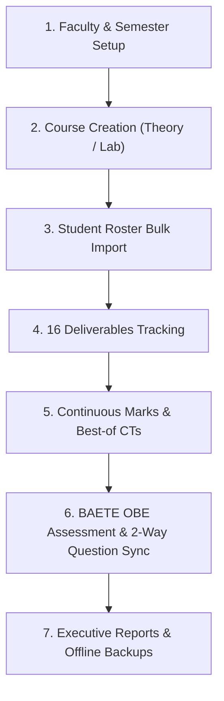

# Academic Portal & Course Management Suite

### Multi-Faculty Course Tracker, Dynamic Gradebook & BAETE OBE Accreditation Platform

[](<file:///e:/Coding/Course%20Tracker%20Fun/course_tracker.html>)
[](<file:///e:/Coding/Course%20Tracker%20Fun/course_tracker.html>)
[](<file:///e:/Coding/Course%20Tracker%20Fun/course_tracker.html>)
[-purple.svg>)](<file:///e:/Coding/Course%20Tracker%20Fun/course_tracker.html>)

---

## 🌟 Overview

The **Academic Portal & Course Management Suite** is a unified, browser-native platform tailored for university instructors, academic coordinators, department heads, and accreditation committees.

It eliminates scattered spreadsheets by combining **Three Essential Academic Engines** into a single offline-first service:

1. **Course Task & Deliverables Tracker**: Centralized tracking across 16 standardized academic milestones with 3-state cycling (`—` &rarr; `✔` &rarr; `✖`) and landscape compliance reporting.
2. **Dynamic Gradebook & Marks Master**: Full support for Theory (`T`) and Sessional/Lab (`L`) courses, dynamic column creation, custom Best-of-N aggregations (e.g. Best 2 of 4 CTs), Excel student roster importing, Grade Proximity Predictor, and real-time SVG GPA distribution charts.
3. **BAETE Outcome-Based Education (OBE) Engine**: 6-step guided Washington Accord accreditation wizard, Bloom's Taxonomy domain/level mappings (C1–C6), question-to-CO mapping, CO-PO correlation matrices (PO1–PO12), Continuous Quality Improvement (CQI) documentation, and a **Two-Way Question Breakdown Engine** that synchronizes question scores directly with Gradebook component totals.

---

## ℹ️ The Top-Bar "i" Information Button

In the top navigation bar, right beside the theme toggle, you will find the **"i" Information Button** (`#btnSystemHelp`):


Clicking this button opens the **Interactive System Workflow Guide & Operational Manual**, featuring 8 tabbed guides with visual diagrams, step-by-step procedures, and power-user tips:

- 🚀 **1. Workflow & Flowchart**: The complete semester lifecycle flowchart from setup to final audit.
- 👥 **2. Faculty & Courses**: Faculty directory, workload calculations, and safe teacher deletion.
- 📋 **3. 16 Deliverables Tracker**: Breakdown of the 16 academic milestones and 3-state cycling rules.
- 📊 **4. Gradebook & Best-of CTs**: Dynamic columns, Best-of-N rules, and the GPA proximity predictor.
- 🎯 **5. BAETE OBE Wizard**: Step-by-step Washington Accord accreditation instructions.
- 📝 **6. 2-Way Question Engine**: Linking individual exam questions to Course Outcomes and syncing totals to Gradebook.
- 📑 **7. Official Reports & PDFs**: Guidance on generating 1-2 page Executive Summary and Detailed Audit dossiers.
- ⚡ **8. Excel Paste & Pro-Tips**: Sequential column copy-pasting and grid navigation shortcuts.

---

## 🚀 How It Works: The Academic Semester Lifecycle



### Step 1: Faculty Directory & Workload Allocation

- **Add Faculty**: Click the `Users` icon in the top bar to open the Faculty Directory. Enter teacher Name, Designation, Faculty Code (e.g., `MRA`), and Email.
- **Workload Dashboard**: The Faculty tab automatically computes and displays the assigned Theory courses, Lab sessions, and total credit hours for each teacher.
- **Department View vs Individual View**: Use the **Faculty Filter** dropdown in the top bar to switch between seeing all courses across the department or filtering down to a specific instructor's courses.
- **Safe Faculty Deletion**: If a faculty member is deleted, the system detects any active courses assigned to them and provides an interactive course reassignment prompt so no grades or milestones are lost.

### Step 2: Course Setup (Theory 'T' vs Lab 'L')

- Create courses under the active semester by clicking **Add Course**.
- Select **Theory Course (T)** or **Sessional / Lab (L)**:
  - **Theory courses** automatically initialize with Attendance (10), CTs (30), Assignment (10), Mid Exam (30), and Final Exam (40).
  - **Lab courses** automatically initialize with Attendance (10), Lab Reports (30), Lab Performance (25), and Final Quiz/Viva (35).
- Assign credit hours, program type (`R` Day or `E` Evening), and assigned instructor.

### Step 3: Student Roster Bulk Import

- In the Gradebook tab, click **Bulk Add / Import**.
- Copy two columns directly from your student Excel spreadsheet:

  ```text
  21225103001    John Doe
  21225103002    Jane Smith
  21225103003    Ahmed Khan
  ```
- Paste into the text box and click **Import Students**. The system automatically parses rows, eliminates duplicates by Student ID, and preserves any existing marks.

### Step 4: Tracking 16 Academic Deliverables

The Deliverables Tracker monitors 16 standardized university milestones:

1. Course Outline & Syllabus
2. Lesson Plan & Lecture Schedule
3. Continuous Assessment Questions
4. Attendance Registers & Eligibility
5. Mid Exam Question Submission
6. Mid Script Evaluation
7. Mid Marks Portal Submission
8. Mid Makeup Exam Delivery
9. Final Question Moderation
10. Final Script Evaluation
11. Final Marks Portal Submission
12. OBE CO Attainment Analysis
13. Course Assessment File Compilation
14. Question Bank Deposit
15. Sessional Viva / Final Project
16. Head of Department Verification

#### 3-State Cycling Interaction

Clicking any cell in the tracker table cycles through three distinct states:

- **Click 1**: `—` (Pending / Blank) &rarr; <span style="color:#22c55e;font-weight:bold;">✔ Completed</span>
- **Click 2**: <span style="color:#22c55e;font-weight:bold;">✔ Completed</span> &rarr; <span style="color:#ef4444;font-weight:bold;">✖ Not Applicable</span> (excluded from compliance denominator)
- **Click 3**: <span style="color:#ef4444;font-weight:bold;">✖ Not Applicable</span> &rarr; `—` (Resets to Pending)

$$
\text{Compliance Progress \%} = \frac{\text{Completed}}{\text{Total Milestones} - \text{Not Applicable}} \times 100\%
$$

Click **Print Tracker** to generate an A4 landscape compliance sheet ready for Department Chairman or Dean review.

### Step 5: Gradebook & Best-of CT Aggregations

- **Presets & Best-of Rules**: Click **⚙ Presets** in the Gradebook toolbar. Group columns (e.g. `CTs` grouping CT1, CT2, CT3, CT4) and set aggregation rules:
  - *Best 2 of 4*
  - *Best 3 of 4*
  - *Sum of All*
  - *Average of All*
- **Proximity Grade Predictor**: Beside each student's current letter grade (e.g. `A-`), the system displays the exact marks needed to jump to the next GPA tier (e.g. `➔ A: +2.5`), helping instructors detect borderline students before portal submission.
- **Real-time GPA Chart**: Click **Show GPA Chart** to view a live SVG distribution histogram across all grade bands (A+, A, A-, B+, B, B-, C+, C, D, F).

### Step 6: BAETE Washington Accord OBE Accreditation

The OBE tab guides instructors through a 6-step accreditation pipeline:

1. **Step 1: Course Info & Credits**: Course catalog description, prerequisites, and contact hours.
2. **Step 2: Course Outcomes (COs)**: Define CO1..CO4 statements and assign Bloom's Taxonomy domain (Cognitive, Affective, Psychomotor) and level (C1–C6).
3. **Step 3: Assessment Segments & Question Mapping**: Configure assessment segments (CT, Assignment, Mid, Final), questions per segment, question weights, and map each question to a specific CO.
4. **Step 4: CO to PO Correlation Matrix**: Map COs to BAETE Program Outcomes PO1 through PO12 with correlation ratings: `1 (Low)`, `2 (Medium)`, `3 (High)`, or `- (None)`.
5. **Step 5: Assessment Marks & Live Attainment**: Enter question scores; view live attainment percentages against target thresholds (default 50% score).
6. **Step 6: Attainment Analysis, Radar Chart & CQI**: Review overall CO and PO attainment percentages, interactive Light-Mode Radar and Bar charts, and record Continuous Quality Improvement (CQI) actions.

### Step 7: Two-Way Question Breakdown Engine

- **The Accreditation Problem**: University grade portals only accept component totals (e.g., *Mid Exam: 24/30*), but BAETE accreditation requires question-level evaluations (e.g., *Q1: 8/10 for CO1, Q2: 9/10 for CO2, Q3: 7/10 for CO3*) because each question measures a different student outcome.
- **⚡ Fully Automatic Real-Time Synchronization (GB ⇄ OBE)**:
  - **No Manual Buttons Needed**: With *⚡ Real-Time Auto-Sync* enabled (on by default), editing a Gradebook total immediately auto-distributes into OBE questions, and editing any question mark immediately updates the Gradebook total!
  - **Direction 1 (OBE Questions &rarr; Gradebook)**: Typing into Q1, Q2, Q3 in Step 5, the Question Breakdown modal, or expanded columns automatically sums and writes to the Gradebook.
  - **Direction 2 (Gradebook &rarr; OBE Questions)**: Typing a mark in Gradebook (e.g. `25` in Mid Exam) automatically distributes `[8.5, 8.5, 8.0]` into OBE questions based on question maximums.
- **🎯 Setting Up & Editing Questions**:
  - When clicking **+ Add Column**, clicking **⚙** on any column header in the Gradebook spreadsheet, or clicking **Edit Column** in the Marks Assessment Columns list, the configuration modal includes the **OBE Question Structure**:
    - **Number of Questions (`nQuestions`)**: Set 1, 2, 3, 4, 5, 6... questions.
    - **Question Weights**: Use **⚖ Auto-Split Marks** to balance question maximums to match the column total, or set custom weights per question.
    - **Course Outcome (CO) Mapping**: Select which Course Outcome (`CO1`, `CO2`, `CO3`, `CO4`) and Bloom's Taxonomy level each question targets.
    - Saving sets up both the Gradebook column and the OBE assessment segment simultaneously before marks are entered!
- **🎯 OBE-First Workflow (Build Gradebook from OBE Blueprint)**:
  - In BAETE / Washington Accord accredited programs, you can configure your assessment architecture in **OBE Step 2 (Assessment Segments)** and **Step 3 (Question-to-CO Weights)** first.
  - Clicking **Build Gradebook From OBE Segments** automatically generates matching Gradebook columns, pre-allocates question weight breakdowns, and establishes the 2-way live sync channel.
  - New courses automatically initialize with standard OBE Theory or Lab assessment segments pre-configured from day one!

### Step 8: Official Audited Reports & Exports

- **1-2 Page Executive Summary Report (A4)**: Formatted strictly for departmental filing and BAETE evaluators. Includes Institution logo, course metadata, Course Outcomes table, Light-Mode Radar Chart, CO-PO attainment matrix, CQI action plan, and official signature lines for Course Teacher and Department Head.
- **Multi-Page Detailed Audit Report (A4)**: Full accreditation dossier with student-by-student question breakdown tables and complete attainment breakdown.
- **Landscape Milestones Compliance Report**: Print directly from the Tracker tab in crisp landscape format.
- **Universal Excel Workbook (.xlsx)**: Export multi-sheet workbooks with tracker, gradebook, and OBE summaries.
- **Complete System JSON Backup (.json)**: One-click export and import of all semesters, faculty, courses, students, OBE matrices, and logos.

---

## ⚡ Power-User Tips & Shortcuts

| Feature                                                              | How to Use                                                                                                                                                                                                                                                                                                                                                |
| :------------------------------------------------------------------- | :-------------------------------------------------------------------------------------------------------------------------------------------------------------------------------------------------------------------------------------------------------------------------------------------------------------------------------------------------------- |
| **Tab Key Direction (`Along Row →` vs `Down Column ↓`)** | Use the **Tab Key** dropdown in the Gradebook toolbar to toggle between **Tab Along Row &rarr;** (Tab moves across student marks; Shift+Tab moves backwards) and **Tab Down Column &darr;** (Tab moves down to the same component for the next student; Shift+Tab moves up). Also works inside Question Breakdown and OBE marks tables! |
| **Enter & Arrow Keys**                                         | Pressing `Enter` or `Arrow Down` moves down the column (like Excel); `Shift+Enter` or `Arrow Up` moves up the column. When moving between cells, cell text is automatically selected for quick overwriting.                                                                                                                                       |
| **Excel Column Pasting**                                       | Select a column of numbers in Excel (`Ctrl+C`), click into the first student's cell in the Gradebook or Question Breakdown sheet, and press `Ctrl+V`. The system sequentially fills the column down row by row.                                                                                                                                       |
| **Grid Navigation**                                            | Use `Arrow Up`, `Arrow Down`, `Enter`, or `Tab` to navigate swiftly across cells without touching your mouse.                                                                                                                                                                                                                                     |
| **Institution & Logo**                                         | Click **Institution** in the top bar to set your University Name, Department, Default Teacher Name, and upload your official University Crest (auto-resized to 320x320 and stored offline).                                                                                                                                                         |
| **Dark & Light Mode**                                          | Click the Moon/Sun icon in the top header. All print reports automatically render in clean paper-white regardless of active theme.                                                                                                                                                                                                                        |
| **Offline Data Safety**                                        | All changes are auto-saved in browser `localStorage`. Periodically download a `.json` backup via `Export ➔ Complete System JSON Backup` for peace of mind.                                                                                                                                                                                         |

---

## 🛠️ Technology Stack

- **Core**: HTML5, Vanilla JavaScript (ES6+), Vanilla CSS3.
- **Icons**: Lucide Icons.
- **Spreadsheets**: SheetJS (`xlsx.full.min.js`) for native `.xlsx` generation.
- **Visualizations**: Custom Canvas API radar charts and scalable SVG grade distribution histograms.
- **Zero Build Tools**: No Node.js, Webpack, or npm dependencies required to run the app. Just open in any browser!

---

## 💻 How to Run Locally

1. Clone or download this repository.
2. Double-click [course_tracker.html](<file:///e:/Coding/Course%20Tracker%20Fun/course_tracker.html>) or open it in any modern browser (Google Chrome, Microsoft Edge, Mozilla Firefox, or Safari).
3. Everything runs locally in your browser with zero installation!
